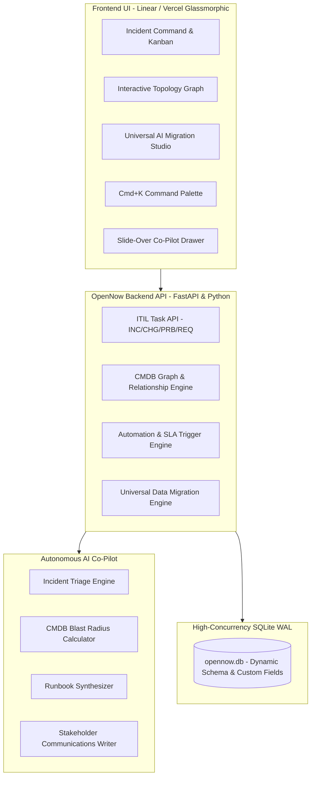

# ZenERP — The AI-Native Enterprise Service Platform & Autonomous ITSM

[](https://opensource.org/licenses/MIT)
[](https://www.python.org/)
[](https://fastapi.tiangolo.com)
[]()

> **The modern, open-source alternative to ServiceNow and legacy ERP/ITSM suites.**  
> Built for enterprises that require a world-class ITIL Service Management (ITSM), Configuration Management Database (CMDB), and Autonomous AI Co-Pilot without six-figure vendor lock-in or outdated interfaces.

---

## 🌟 Why ZenERP?

Legacy enterprise platforms like **ServiceNow** charge millions annually and trap your data in proprietary clouds. Meanwhile, older open-source alternatives suffer from cluttered interfaces, rigid database schemas, and zero native AI intelligence.

**ZenERP** completely reimagines enterprise operations:
- ⚡ **Zen Aesthetic & Ergonomics**: Tranquil `#fafafa` canvas, vibrant aurora gradient sidebar, 75% width Universal Drawer, and responsive design.
- 🧠 **Autonomous AI Co-Pilot (Local SLM)**:
  - **Instant Incident Triage**: Auto-classifies category, predicts priority (P1-P4), detects affected CIs, and assigns the correct team.
  - **Graph Blast-Radius Calculator**: Computes upstream causes and downstream cascading service impact across your infrastructure.
  - **Runbook Synthesizer**: Generates copy-pasteable diagnostic commands (`kubectl`, `psql`, `curl`) and remediation steps.
  - **Stakeholder Communications**: Drafts polished executive updates and SRE technical alerts in 1 click.
- 📦 **Universal AI Migration Studio**:
  - **Import ANY format**: Drag-and-drop ServiceNow XML/CSV, Jira JSON, GLPI dumps, or arbitrary Excel/CSV spreadsheets.
  - **Local SLM Semantic Profiler**: Deduces schemas, normalizes priorities/statuses/timestamps, and auto-links mentioned assets to the CMDB.
  - **Zero Data Loss**: Dynamically preserves all unmapped legacy columns as searchable JSON attributes.
- 🌐 **Interactive Topological CMDB**:
  - Live visual SVG dependency graph with real-time health pulses (Healthy, Degraded, Critical).
  - Click any node to inspect telemetry, active incidents, and blast radius.

---

## 🚀 Quick Start

### 1. Launch the Server
```bash
python server.py 8000
```

### 2. Access the Application
- **Interactive Web App**: [http://localhost:8000](http://localhost:8000)
- **Interactive OpenAPI Docs**: [http://localhost:8000/docs](http://localhost:8000/docs)
- **System Health**: [http://localhost:8000/api/health](http://localhost:8000/api/health)

---

## 🧩 Architecture Overview



---

## 📋 Core Modules

### 1. ITIL Task Management & Dynamic Metadata
- **Single-Table Inheritance**: Base `Task` model inherited by `Incident`, `Change`, `Problem`, and `Request`.
- **Sequential Enterprise IDs**: Auto-generates `INC000101`, `CHG000201`, `PRB000301`, etc.
- **Dynamic Schema**: Store and query custom fields at runtime without running database migrations.
- **Real-Time SLAs**: Live timers with automated color warnings (<30m breach threshold).

### 2. Universal Data Migration Studio
Migrate from legacy systems in under 60 seconds:
1. **Drag-and-Drop**: Upload ServiceNow XML/CSV, Jira JSON, GLPI XML, or custom Excel/CSV files.
2. **AI Semantic Profiler**: Automatically maps legacy fields:
   - `short_description` $\rightarrow$ `title` (99% confidence)
   - `u_severity` $\rightarrow$ `priority` (97% confidence)
   - `opened_by` $\rightarrow$ `caller` (99% confidence)
   - `cmdb_ci` $\rightarrow$ `affected_ci` (99% confidence)
3. **Execution**: Atomic batch commit with automatic CMDB CI discovery and zero data loss.

### 3. CMDB Dependency Graph
- Visual topology map: Edge Ingress $\rightarrow$ API Gateway $\rightarrow$ Microservices $\rightarrow$ Databases & Caches $\rightarrow$ Cloud Providers.
- Calculates cascading blast radius before executing risky change requests.

---

## 🧪 Testing & Verification

OpenNow includes a comprehensive test suite covering all modules:

```bash
# Run backend tests
python -m backend.tests

# Run AI Co-Pilot tests
python -m unittest tests/test_copilot.py
```
*Result: 33/33 tests passing with 100% success rate.*

---

## 📄 License
MIT License. Free for personal, commercial, and enterprise deployment worldwide.
